<!-- RunyShark · GitHub profile. Panels are generated by scripts/profile (see scripts/profile/DESIGN.md). -->

<!-- Hero -->


<!-- Contact -->

&nbsp;
&nbsp;

<!-- Live counters -->

 

<!-- 01 · About -->


 

<!-- 02 · Impact (data refreshed daily by .github/workflows/profile.yml) -->



 

<!-- 03 · Coding activity (WakaTime) -->

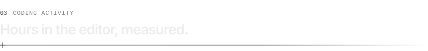

 

<!-- 04 · Stack -->

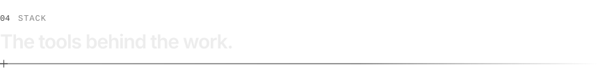
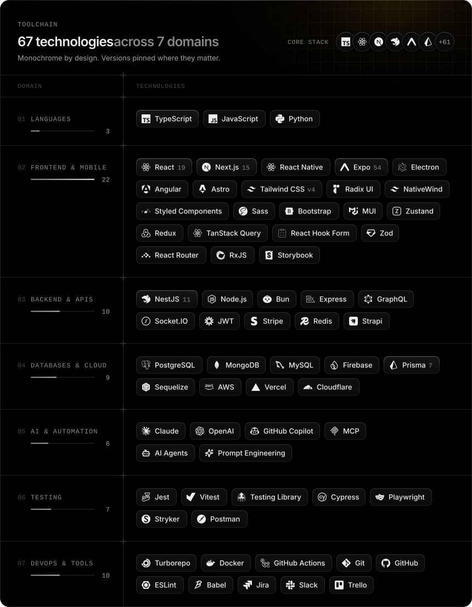

 

<!-- 05 · Certifications -->


<b>Certificate gallery</b> &nbsp;·&nbsp; 15 Udemy previews

 
<table>
<tr>
<td align="center"></td>
<td align="center"></td>
<td align="center"></td>
</tr>
<tr>
<td align="center"></td>
<td align="center"></td>
<td align="center"></td>
</tr>
<tr>
<td align="center"></td>
<td align="center"></td>
<td align="center"></td>
</tr>
<tr>
<td align="center"></td>
<td align="center"></td>
<td align="center"></td>
</tr>
<tr>
<td align="center"></td>
<td align="center"></td>
<td align="center"></td>
</tr>
</table>

<b>Udemy certificates</b> &nbsp;·&nbsp; 20 PDFs

 

| # | Certificate | Credential |
| :-: | :-- | :-: |
| 01 | Udemy · `UC-71159d27-3038-41f2-8712-9c83c0d2fa36` | [View ↗](https://udemy-certificate.s3.amazonaws.com/pdf/UC-71159d27-3038-41f2-8712-9c83c0d2fa36.pdf) |
| 02 | Udemy · `UC-887194f3-c135-4f03-a094-dec8f7acd831` | [View ↗](https://udemy-certificate.s3.amazonaws.com/pdf/UC-887194f3-c135-4f03-a094-dec8f7acd831.pdf) |
| 03 | Udemy · `UC-ba93e0ec-bd63-4123-9371-1f54a86fda81` | [View ↗](https://udemy-certificate.s3.amazonaws.com/pdf/UC-ba93e0ec-bd63-4123-9371-1f54a86fda81.pdf) |
| 04 | Udemy · `UC-2f72d31e-5989-4f5b-8853-7cf7fd6a0007` | [View ↗](https://udemy-certificate.s3.amazonaws.com/pdf/UC-2f72d31e-5989-4f5b-8853-7cf7fd6a0007.pdf) |
| 05 | Udemy · `UC-8ac43057-f130-4557-8332-41146c2949d0` | [View ↗](https://udemy-certificate.s3.amazonaws.com/pdf/UC-8ac43057-f130-4557-8332-41146c2949d0.pdf) |
| 06 | Udemy · `UC-2450ea75-3e16-4dad-bdea-1ba179ec0f46` | [View ↗](https://udemy-certificate.s3.amazonaws.com/pdf/UC-2450ea75-3e16-4dad-bdea-1ba179ec0f46.pdf) |
| 07 | Udemy · `UC-779c347c-46c5-4095-a54e-d3298c674350` | [View ↗](https://udemy-certificate.s3.amazonaws.com/pdf/UC-779c347c-46c5-4095-a54e-d3298c674350.pdf) |
| 08 | Udemy · `UC-992410e2-b065-468c-b194-f1834f9a577e` | [View ↗](https://udemy-certificate.s3.amazonaws.com/pdf/UC-992410e2-b065-468c-b194-f1834f9a577e.pdf) |
| 09 | Udemy · `UC-822c864f-fb3e-422f-88b7-2a0daf804a87` | [View ↗](https://udemy-certificate.s3.amazonaws.com/pdf/UC-822c864f-fb3e-422f-88b7-2a0daf804a87.pdf) |
| 10 | Udemy · `UC-e066f3dd-a5a6-4448-ad7d-010e727fc985` | [View ↗](https://udemy-certificate.s3.amazonaws.com/pdf/UC-e066f3dd-a5a6-4448-ad7d-010e727fc985.pdf) |
| 11 | Udemy · `UC-4bf8773f-d982-4ba3-b85b-59071db805cb` | [View ↗](https://udemy-certificate.s3.amazonaws.com/pdf/UC-4bf8773f-d982-4ba3-b85b-59071db805cb.pdf) |
| 12 | Udemy · `UC-999cb8a3-4efa-439d-85fe-f2f754005557` | [View ↗](https://udemy-certificate.s3.amazonaws.com/pdf/UC-999cb8a3-4efa-439d-85fe-f2f754005557.pdf) |
| 13 | Udemy · `UC-b2b685bc-e3cc-4526-aada-7f7fc014d789` | [View ↗](https://udemy-certificate.s3.amazonaws.com/pdf/UC-b2b685bc-e3cc-4526-aada-7f7fc014d789.pdf) |
| 14 | Udemy · `UC-9ecc0cd3-1963-4f9c-87df-3da6bcc1d378` | [View ↗](https://udemy-certificate.s3.amazonaws.com/pdf/UC-9ecc0cd3-1963-4f9c-87df-3da6bcc1d378.pdf) |
| 15 | Udemy · `UC-a3b7145b-de8a-4b17-ae8e-421af4600279` | [View ↗](https://udemy-certificate.s3.amazonaws.com/pdf/UC-a3b7145b-de8a-4b17-ae8e-421af4600279.pdf) |
| 16 | Udemy · `UC-37c4b311-29c5-4818-9914-c5b8b495ac8c` | [View ↗](https://udemy-certificate.s3.amazonaws.com/pdf/UC-37c4b311-29c5-4818-9914-c5b8b495ac8c.pdf) |
| 17 | Udemy · `UC-685fc082-2d57-4f6c-9183-73a749b78b64` | [View ↗](https://udemy-certificate.s3.amazonaws.com/pdf/UC-685fc082-2d57-4f6c-9183-73a749b78b64.pdf) |
| 18 | Udemy · `UC-62d89a10-02f5-42bd-9173-126268feacdb` | [View ↗](https://udemy-certificate.s3.amazonaws.com/pdf/UC-62d89a10-02f5-42bd-9173-126268feacdb.pdf) |
| 19 | Udemy · `UC-3c66aa61-6ca0-4538-99b3-5b4e6e5b44be` | [View ↗](https://udemy-certificate.s3.amazonaws.com/pdf/UC-3c66aa61-6ca0-4538-99b3-5b4e6e5b44be.pdf) |
| 20 | Udemy · `UC-aa4304ef-ccee-4927-bef0-f887b1754685` | [View ↗](https://udemy-certificate.s3.amazonaws.com/pdf/UC-aa4304ef-ccee-4927-bef0-f887b1754685.pdf) |

<b>DevTalles certificates</b> &nbsp;·&nbsp; 5 credentials

 

| # | Certificate | Credential |
| :-: | :-- | :-: |
| 01 | DevTalles · `vq6skylywa` | [View ↗](https://cursos.devtalles.com/certificates/vq6skylywa) |
| 02 | DevTalles · `2pxghejbg4` | [View ↗](https://cursos.devtalles.com/certificates/2pxghejbg4) |
| 03 | DevTalles · `puokbdneuy` | [View ↗](https://cursos.devtalles.com/certificates/puokbdneuy) |
| 04 | DevTalles · `pinjd1dtv1` | [View ↗](https://cursos.devtalles.com/certificates/pinjd1dtv1) |
| 05 | DevTalles · `vqkxytr10b` | [View ↗](https://cursos.devtalles.com/certificates/vqkxytr10b) |

 

<!-- 06 · GitHub analytics (third-party widgets, themed to the same palette) -->


&nbsp;

<a href="https://github.com/RunyShark">
<picture>
<source media="(prefers-reduced-motion: reduce)" srcset="./profile-3d-contrib/profile-vercel-static.svg" />
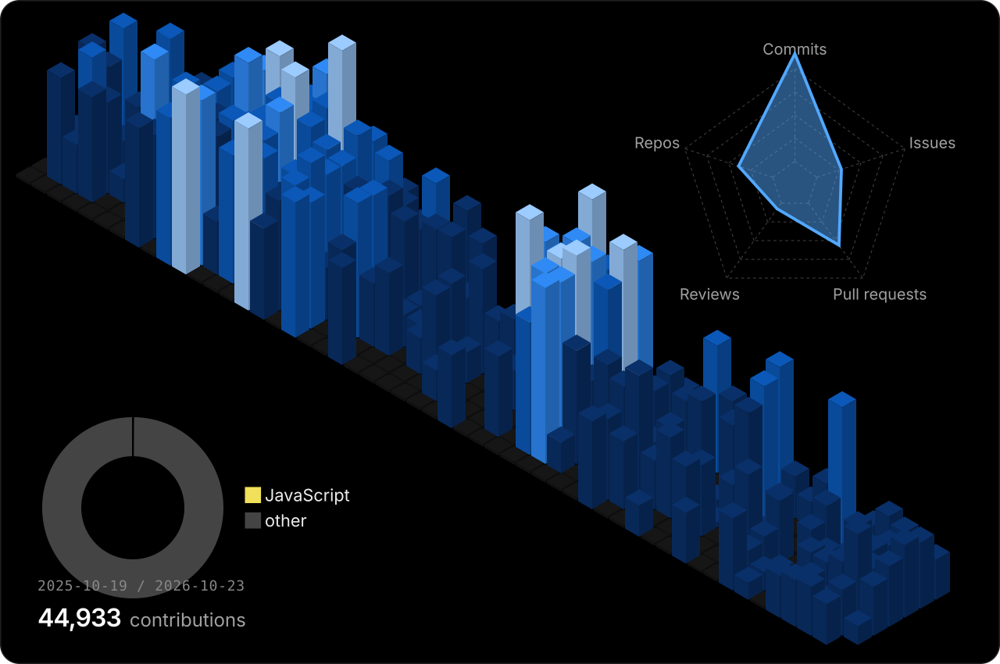
</picture>
</a>

<a href="https://github.com/RunyShark">
<picture>
<source media="(prefers-color-scheme: dark)" srcset="https://raw.githubusercontent.com/RunyShark/RunyShark/output/github-snake-dark.svg" />
<source media="(prefers-color-scheme: light)" srcset="https://raw.githubusercontent.com/RunyShark/RunyShark/output/github-snake.svg" />

</picture>
</a>

<!-- 07 · Now playing: hidden while the Spotify widget token is revoked. Re-authorise at
     spotify-github-profile.kittinanx.com/api/login, then restore the section (see scripts/profile/DESIGN.md §5). -->

 

<!-- Footer -->


